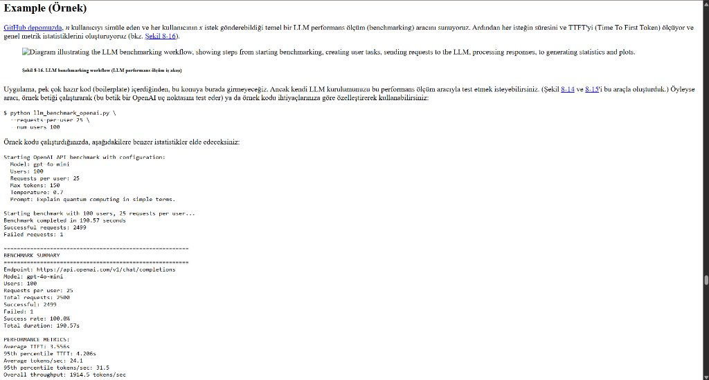
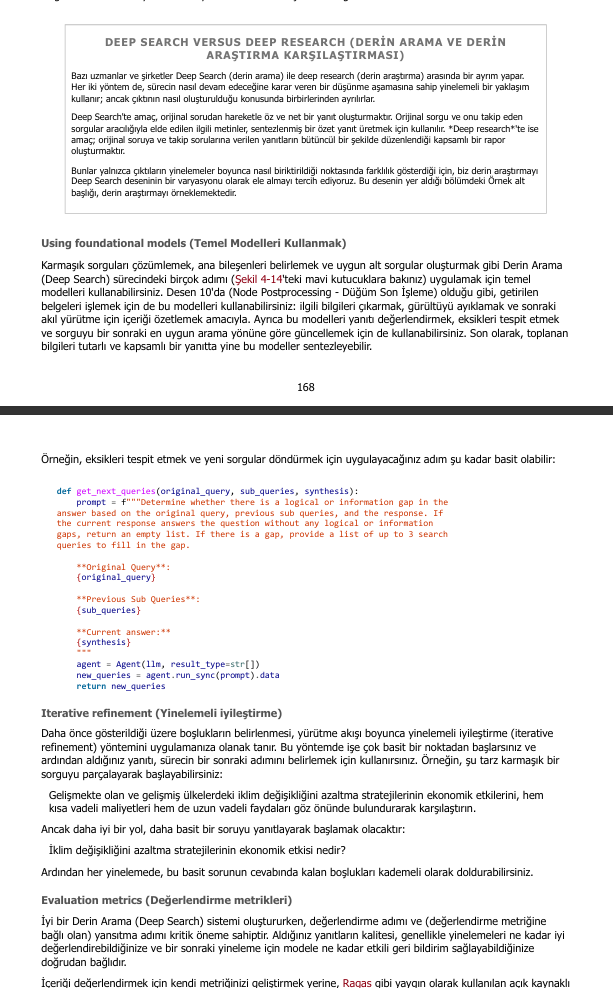
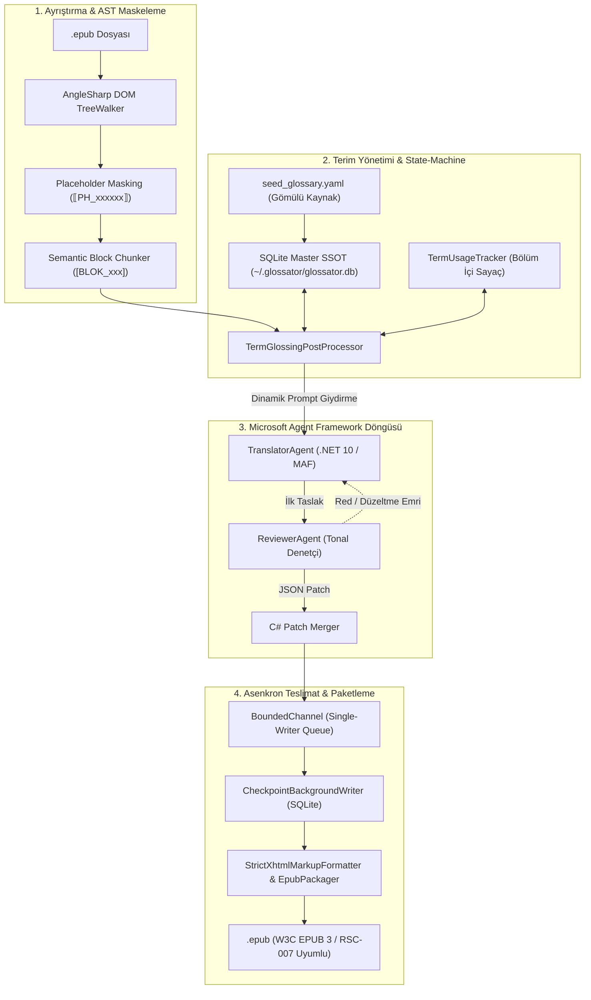

<div align="center">

# GLOSSATOR

**Teknik E-Kitap Yerelleştirme ve Terim Yönetim Motoru**  
*Enterprise Technical Book Localization & Terminology Governance Engine*

[](https://dotnet.microsoft.com/)
[](https://github.com/microsoft/agent-framework)
[](https://github.com)
[](https://github.com)
[](LICENSE)

<br/>

> **"Teknik literatürü ana dilde okurken yaşanan bilişsel yorgunluğu ortadan kaldıran; ancak sektör standardı İngilizce jargondan koparmayan ve AST düzeyinde kod bütünlüğünü %100 koruyan yeni nesil doküman yerelleştirme motoru."**

</div>

---

## Çözülen Problem: Geleneksel Çeviri Araçları Neden Yetersiz Kalır?

Teknik bir kitabı (O'Reilly, Manning, Pragmatic Bookshelf vs) DeepL, Google Translate, Calibre eklentileri veya standart Python betikleriyle çevirmeye çalıştığınızda üç temel sorunla karşılaşırsınız:

1. **Kod Bloklarının Bozulması:** Çeviriciler kodların içindeki değişkenleri, komut satırı argümanlarını (`--requests-per-user` ➔ `--kullanıcı-başına-istek`) ve Python `f-string` girintilerini tercüme ederek kodu çalışmaz hale getirir.
2. **EPUB Omurgasının ve CSS Düzeninin Çökmesi:** HTML/XHTML düğüm hiyerarşisi bozulur, callout kutuları ezilir ve EPUB W3C standart hatası (RSC-007) vererek e-okuyucularda açılmaz.
3. **Terminoloji İkilemi (Bilişsel Yük vs. Jargondan Kopuş):**
   * Ya her şey aşırı Türkçeleştirilir (*"iş parçacığı havuzu"*, *"çöp toplayıcı"*, *"kalıp kod"*) ve mühendis terminal başına geçtiğinde ne arayacağını bilemez;
   * Ya da yabancı dilde okunur ve iş çıkışında metroda/tablette okurken aşırı zihinsel yorgunluk yarattığı için kitap 20. sayfada terk edilir.

**Glossator'ın Çözümü:**
* **AngleSharp AST Düğüm Ağacı Maskelemesi:** Kod blokları, etiketler ve f-stringler `⟦PH_000001⟧` belirteçleriyle kriptografik olarak kilitlenir; model koda fiziksel olarak temas edemez.
* **Hibrit Pedagojik Terminoloji:** Sektör standardı kavramlar ilk geçişte `Türkçe (İngilizce)` olarak tanıtılır (`hazır kod (boilerplate)`, `TTFT'yi (Time To First Token)`), okuyucu akıcı dilde kavrar ama evrensel jargondan kopmaz.

---

## Canlı Çeviri Çıktıları (Sahada Doğrulandı)

Glossator bizzat **3 tam teknik kitap** (yüz binlerce kelime ve karmaşık kod blokları) üzerinde test edilmiş ve sıfır biçimlendirme kaybıyla EPUB standardında teslim edilmiştir:

| Orijinal Kod & İki Dilli Hibrit Terimler | Python f-string ve Callout Kutusu Bütünlüğü |
| :---: | :---: |
|  |  |
| *Python CLI parametreleri ve `TTFT'yi (Time To First Token)` gibi ekler korunur.* | *O'Reilly Callout kutusu stili ve Python girintileri 1 piksel bile sapmaz.* |

---

## Mimari Tasarım (Enterprise Architecture)

Glossator; deterministik kural motoru, asenkron kanallar ve Microsoft Agent Framework döngüsünü birleştiren 4 katmanlı bir mimariye sahiptir:



---

## 3 Seviyeli Terim Politikası (Glossing Policy Engine)

Glossator veritabanında her terim deterministik bir durum makinesine bağlıdır:

| Politika | Enum | Açıklama | Örnek Çıktı |
| :--- | :---: | :--- | :--- |
| **`ProgressiveGloss`** | `0` | **Aşamalı Pedagojik Tanıtım:** Bölüm içinde ilk 2 geçişte hibrit, sonraki geçişlerde yalın Türkçe. | `hazır kod (boilerplate)` ➔ `hazır kod` |
| **`AlwaysEnglish`** | `1` | **Dokunulmaz Sektör Jargonu:** Markalar, protokoller, SDK'ler ve kısaltmalar asla çevrilmez. | `LLM`, `REST API`, `Docker`, `Kubernetes` |
| **`AlwaysTurkish`** | `2` | **Düz Teknik Terimler:** Doğrudan yerleşik Türkçe karşılık kullanılır, parantez açılmaz. | `veri` *(data)*, `maliyet` *(cost)*, `modeller` |

### Karantina / Staging Sözlük Mimarisi
Yeni bir kitap işlendiğinde `--extract-terms` bayrağı ile çıkarılan ham dizin kelimeleri **asla ana veritabanını kirletmez.** 
Kitap klasörüne `glossary.extracted.yaml` olarak kaydedilir. Kullanıcı inceleyip onayladıklarını tek komutla Master SSOT havuzuna aktarır:

```bash
glossator glossary import -i ./glossary.extracted.yaml
```

---

## Dağıtım Paketi Dizin Yapısı (Distribution Layout)

Glossator, .NET 10 çalışma zamanını kendi bünyesinde barındıran bağımsız bir paket olarak dağıtılır. Makinenizde hiçbir SDK veya C# derleyicisi kurulu olmak zorunda değildir:

```text
glossator-release-win-x64/
│
├── glossator.exe              # Bağımsız ana motor (.NET 10 runtime içerir, kurulumsuz çalışır)
├── e_sqlite3.dll              # Yerel SQLite C çalışma kütüphanesi (Terim veritabanı için zorunludur, silmeyiniz)
├── appsettings.json           # Model, API anahtarı, endpoint ve oran sınırlandırma yapılandırması
├── appsettings.example.json   # Kurumsal yedek yapılandırma şablonu
│
└── Prompts/                   # Dışarıdan düzenlenebilir sistem istemleri (KOD DERLEME GEREKTİRMEZ)
    ├── StyleAnalystPrompt.md  # 1. Ajan: Yazarın sesini, üslup ve ton haritasını çıkaran direktör
    ├── TranslatorPrompt.md    # 2. Ajan: AST/XHTML uyumlu pedagojik hibrit çevirmen
    └── ReviewerPrompt.md      # 3. Ajan: Tonal kalibrasyon ve JSON Patch üreten baş editör
```

> [!IMPORTANT]
> **`e_sqlite3.dll` Dosyası:** Windows üzerinde SQLite motorunun yerel C seviyesinde yüksek performansla çalışmasını sağlar. Bu dosyanın `glossator.exe` ile aynı klasörde kalması zorunludur.

---

## Yapılandırma ve AI Sağlayıcı Entegrasyonu (Multi-Provider Support)

Glossator, .NET 10 `Microsoft.Extensions.AI` soyutlaması üzerinden tüm **OpenAI-uyumlu (OpenAI-compatible)** LLM uç noktalarını yerel olarak destekler. Kodu yeniden derlemenize gerek yoktur; `glossator.exe` dosyasının yanındaki `appsettings.json` dosyasını düzenlemeniz yeterlidir.

### Temel Yapılandırma (`appsettings.json`)

```json
{
  "GlossatorAi": {
    "ActiveProvider": "Evren",
    "Providers": {
      "Evren": {
        "Endpoint": "https://evren-llmapi.ssyz.org.tr/v1",
        "ApiKey": "YOUR_EVREN_API_KEY",
        "DefaultModel": "deepseek-v4.1-flash"
      },
      "OpenAI": {
        "Endpoint": "https://api.openai.com/v1",
        "ApiKey": "YOUR_OPENAI_API_KEY",
        "DefaultModel": "gpt-4o"
      },
      "Gemini": {
        "Endpoint": "https://generativelanguage.googleapis.com/v1beta/openai/",
        "ApiKey": "YOUR_GEMINI_API_KEY",
        "DefaultModel": "gemini-2.5-flash"
      },
      "Custom": {
        "Endpoint": "https://your-custom-endpoint/v1",
        "ApiKey": "YOUR_CUSTOM_API_KEY",
        "DefaultModel": "your-model-name"
      }
    }
  }
}
```

### Sağlayıcı Kullanım Senaryoları

#### Senaryo 1: SSB EVREN LLM API (Varsayılan)
Türkiye Cumhuriyeti Savunma Sanayii Başkanlığı EVREN Portalı altyapısını kullanmak için:
```json
"ActiveProvider": "Evren"
```
ve `Providers.Evren.ApiKey` alanına EVREN anahtarınızı yazın.

#### Senaryo 2: OpenAI (Resmi API)
Doğrudan OpenAI modellerini (`gpt-4o`, `gpt-4o-mini`) kullanmak için:
```json
{
  "GlossatorAi": {
    "ActiveProvider": "OpenAI",
    "Providers": {
      "OpenAI": {
        "Endpoint": "https://api.openai.com/v1",
        "ApiKey": "sk-proj-KENDI_OPENAI_ANAHTARINIZ",
        "DefaultModel": "gpt-4o"
      }
    }
  }
}
```
*Tüm ajanlar otomatik olarak `gpt-4o` modeline bağlanır ve sistem diğer sağlayıcıların anahtarını istemez.*

#### Senaryo 3: Google Gemini
Google AI Studio üzerinden OpenAI-uyumlu Gemini endpoint'ini kullanmak için:
```json
{
  "GlossatorAi": {
    "ActiveProvider": "Gemini",
    "Providers": {
      "Gemini": {
        "Endpoint": "https://generativelanguage.googleapis.com/v1beta/openai/",
        "ApiKey": "AIzaSy...",
        "DefaultModel": "gemini-2.5-flash"
      }
    }
  }
}
```

#### Senaryo 4: Yerel / Çevrimdışı Mod (Ollama, LM Studio, vLLM)
Verilerinizin makinenizden dışarı çıkmasını istemiyorsanız, yerel modelleri tamamen ücretsiz ve çevrimdışı çalıştırabilirsiniz. Localhost bağlantılarında Glossator API anahtarı denetimini otomatik olarak atlar:
```json
{
  "GlossatorAi": {
    "ActiveProvider": "Custom",
    "Providers": {
      "Custom": {
        "Endpoint": "http://localhost:11434/v1",
        "ApiKey": "ollama",
        "DefaultModel": "qwen2.5:32b"
      }
    }
  }
}
```
*(LM Studio için endpoint: `http://localhost:1234/v1`, vLLM için: `http://localhost:8000/v1`)*

#### Senaryo 5: Özel Proxy veya Diğer LLM Servisleri (Groq, DeepSeek, OpenRouter)
OpenAI standardını destekleyen herhangi bir üçüncü parti servisi `Custom` altına tanımlayabilirsiniz:
```json
{
  "GlossatorAi": {
    "ActiveProvider": "Custom",
    "Providers": {
      "Custom": {
        "Endpoint": "https://api.groq.com/openai/v1",
        "ApiKey": "gsk_...",
        "DefaultModel": "llama-3.3-70b-versatile"
      }
    }
  }
}
```

---

## İstem (Prompt) Yönetim Mimarisi ve Sıfır-Kod Özelleştirme

Glossator'ın en güçlü mimari yönlerinden biri; sistemin yapay zekâ mantığını **C# koduna gömmemiş olmasıdır.** Tüm ajan rolleri, kurallar ve denetim kriterleri `Prompts/` klasörü altındaki standart Markdown dosyalarında yaşar.

### 1. Üç Ajanlı İş Akışı ve İstemlerin Görevleri

| İstem Dosyası | Ajan Rolü | Görevi ve Çalışma Prensibi |
| :--- | :--- | :--- |
| **`StyleAnalystPrompt.md`** | **Üslup & Ton Direktörü** | Bölümün ilk 2.500 karakterini analiz ederek yazarın sesini, hitap kipini ve mühendislik yaklaşımını çıkarır. Bölüm başında bir kez çalışır ve ürettiği `[YAZAR ÜSLUP KILAVUZU]` diğer iki ajanın KV-Cache prefix'ine yerleşir. |
| **`TranslatorPrompt.md`** | **Kıdemli Çevirmen** | AST maskelemesi yapılmış `[BLOK_xxx]` parçalarını, sözlükteki terimleri ve üslup kılavuzunu harmanlayarak akıcı Türkçeye çevirir. Başlıklar için zorunlu `İngilizce (Türkçe)` kuralını uygular. |
| **`ReviewerPrompt.md`** | **Baş Editör & Redaktör** | Çeviri taslağını orijinal metinle kıyaslar. Aşırı robotik veya yapay felsefi sapmaları dengeler. Tüm metni yeniden yazmak yerine token tasarrufu sağlayan **JSON Patch** sözleşmesiyle yalnızca hatalı blokları düzeltir. |

### 2. Disk-First Öncelik Mimarisi (Nasıl Çalışır?)

Glossator'ın `PromptLoader` servisi disk öncelikli bir mimariye sahiptir:
1. **Birincil Öncelik (Kullanıcı Özelleştirmesi):** Motor, öncelikle `glossator.exe` yanındaki `Prompts/` klasörünü (veya kitap çalışma dizinini) tarar. Dosya diskte mevcutsa doğrudan diskten yükler.
2. **İkincil Öncelik (Varsayılan Fabrika Ayarları):** Eğer `Prompts/` klasörü silinmiş veya bulunamıyorsa, motor binary içerisine derlenmiş gömülü kaynaklara (Embedded Resource) geri düşer.

Bu sayede:
* Kullanıcılar Not Defteri veya VS Code ile `Prompts/*.md` dosyalarını açıp düzenlediklerinde, değişiklikler **derleme gerektirmeden bir sonraki çalıştırmada anında devreye girer.**
* Dağıtılan `Prompts/` klasörü kaybolsa dahi `glossator.exe` çalışmayı sürdürür.

### 3. Sıfır C# Kodu ile Kuralları Özelleştirme

`Prompts/TranslatorPrompt.md` dosyasını açarak kurumunuza veya projenize özel kuralları saniyeler içinde ekleyebilirsiniz:

```markdown
### 5. Yasaklı Robotik Çeviri Kalıpları:
- `tetiklemek` yerine bağlama göre `başlatmak` veya `yol açmak` kullanın.
- `anlamı sulandı` KESİNLİKLE YASAK! => `kavramın içi boşaldı` kullanın.
- Şirket içi jargonumuz gereği `pipeline` kelimesi `akış hattı` olarak çevrilmelidir.
```

---

## Farklı Teknik ve Bilimsel Alanlara Uyarlama (Multi-Domain Adaptation)

Glossator varsayılan olarak yazılım mühendisliği (O'Reilly / Manning) standartlarıyla gelir. Ancak motor tamamen alan-bağımsızdır (domain-agnostic). Farklı disiplinlerdeki bir kitabı yerelleştirmek için `Prompts/` şablonlarını birkaç dakikada uyarlayabilirsiniz:

### 1. Tıp ve Sağlık Bilimleri (Medical & Clinical)
* **`StyleAnalystPrompt.md`:** Yazar kimliğini *"Klinisyen hekim, tanı ve tedavi rehberi tonu; nötr, kesin ve şüpheye yer bırakmayan tıp literatürü dili"* olarak tanımlayın.
* **`TranslatorPrompt.md`:** 
  * Kural 2 başlık örneklerini uyarlayın: `Myocardial Infarction (Miyokard Enfarktüsü)`, `Double-Blind Study (Çift Kör Çalışma)`.
  * Dokunulmazlar listesine Latince anatomik isimleri (`Vena cava`, `Arteria pulmonalis`) ekleyin.
  * Bağlamsal ayrım (Disambiguation): *"discharge"* kelimesinin elektrik deşarjı değil, **taburcu olma** veya **akıntı** olduğunu belirtin.

### 2. Biyoloji ve Yaşam Bilimleri (Genetics & Life Sciences)
* **`StyleAnalystPrompt.md`:** *"Nature/Science hakemli dergi standardında akademik araştırmacı ve laboratuvar dili."*
* **`TranslatorPrompt.md`:**
  * Başlık örnekleri: `Gene Expression (Gen İfadesi)`, `Transcription Factor (Transkripsiyon Faktörü)`.
  * Dokunulmazlar: İkili adlandırma (binomial nomenclature) tür adları italik korunur (`Escherichia coli`, `Homo sapiens`), restriksiyon enzimleri (`EcoRI`).
  * DNA/RNA sekansları (`ATCG...`), FASTA blokları ve kimyasal formüller `<pre>`, `<code>` ve `<math>` etiketleriyle zaten kriptografik olarak kilitlenir.

### 3. Hukuk ve Mevzuat (Legal Studies)
* **`StyleAnalystPrompt.md`:** *"Mevzuat ve içtihat diline tam sadık, bağlayıcı, normatif, yoruma kapalı formel hukuk dili."*
* **`TranslatorPrompt.md`:** 
  * Başlık örnekleri: `Due Process (Adil Yargılanma Hakkı)`, `Force Majeure (Mücbir Sebep)`, `Burden of Proof (İspat Yükü)`.
  * Dokunulmazlar: Latince evrensel hukuk deyimleri (`de facto`, `prima facie`, `pacta sunt servanda`, `ultra vires`).
  * Bağlamsal ayrım: *"action"* kelimesinin eylem değil, **dava**; *"consideration"* kelimesinin saygı değil, sözleşmedeki **ivaz/karşılık** olduğunu tanımlayın.

### 4. Makine ve İnşaat Mühendisliği (Engineering Mechanics)
* **`StyleAnalystPrompt.md`:** *"Uluslararası standartlara (ISO, DIN, ASTM) bağlı, doğrudan ve hesaplamaya dayalı analitik mühendislik üslubu."*
* **`TranslatorPrompt.md`:**
  * Başlık örnekleri: `Finite Element Analysis (Sonlu Elemanlar Analizi)`, `Yield Strength (Akma Mukavemeti)`.
  * Dokunulmazlar: Standart kodları (`EN 1993-1-1`, `ASTM A36`) ve birim kısaltmaları (`MPa`, `kN/m²`).

---

## Hızlı Başlangıç (Quickstart)

### 1. Bağımsız Çalıştırılabilir Dosya (Kurulumsuz)
Kullanıcının makinesinde .NET SDK veya runtime kurulu olması gerekmez. Dağıtım paketindeki `glossator.exe` dosyasını indirip doğrudan çalıştırabilirsiniz:

```powershell
# Temel Çeviri Hattını Başlat
glossator.exe "C:\Kitaplar\Designing-Data-Intensive-Applications.epub" -o "DDIA_TR.epub" -j 3
```

### 2. CLI Komutları ve Sözlük Yönetimi

```powershell
# İnteraktif TUI Kontrol Panelini Aç
glossator

# Sözlükteki Terimleri Listele & Filtrele
glossator glossary list --policy ProgressiveGloss --search "agent"

# Yeni Terim Ekle
glossator glossary add -e "zero-shot learning" -t "sıfır örnekli öğrenme" -p ProgressiveGloss

# Sözlüğü Git-Dostu YAML Formatında Dışa Aktar
glossator glossary export master_glossary.yaml -f yaml

# Dışarıdan Sözlük İçe Aktar
glossator glossary import team_glossary.yaml
```

### 3. PDF ve Farklı Formatlar İçin Dönüşüm Kılavuzu (Calibre Entegrasyonu)

Glossator; W3C EPUB 3 standartlarını, katı XHTML omurgasını ve DOM hiyerarşisini %100 korumak amacıyla birincil olarak **EPUB (`.epub`)** formatıyla çalışır. Ancak teknik e-kitap dünyasında PDF ihtiyacı kaçınılmazdır.

Açık kaynaklı **Calibre** araç seti kullanılarak iki yönlü akış pratik ve kayıpsız şekilde kurulabilir:

#### A. Çevrilen EPUB'ı Profesyonel PDF'e Dönüştürme
Glossator'ın ürettiği Türkçe `.epub` dosyasını tablet, e-mürekkep okuyucu veya yazdırma için doğrudan PDF'e dönüştürebilirsiniz:

```powershell
# Calibre CLI (ebook-convert) ile kayıpsız PDF çıktısı alma
ebook-convert "Kitap_TR.epub" "Kitap_TR.pdf" --paper-size a4 --pdf-page-numbers --margin-left 36 --margin-right 36
```
*(Alternatif olarak Calibre Masaüstü Arayüzü: Kitaba sağ tıklayın ➔ Kitapları Dönüştür ➔ Çıktı Biçimi: PDF ➔ Tamam)*

*Glossator'ın ürettiği katı XHTML kod blokları, callout kutuları ve CSS stilleri, Calibre motoru tarafından hiçbir biçimlendirme kaybı yaşanmadan kusursuz bir PDF mizanpajına dönüştürülür.*

#### B. Elinizdeki PDF Kitabı EPUB'a Dönüştürüp Çevirme
Elinizde yalnızca PDF formatında bir kitap varsa:
1. Calibre arayüzünde PDF'i içe aktarın ve **Çıktı Biçimi: EPUB** olarak dönüştürün (veya iki sütunlu metinler için `k2pdfopt` kullanın).
2. Üretilen `.epub` dosyasını Glossator hattına verin:
   ```powershell
   glossator.exe "kitap.epub" -o "kitap_tr.epub" -j 3
   ```
3. Çıktıyı dilerseniz yukarıdaki Calibre komutuyla yeniden PDF'e aktararak okuyun.

---

## Kurumsal Altyapı Özellikleri

* **Dinamik Sağlayıcı ve Model Eşleme:** `ActiveProvider` değiştirildiğinde ajanlar otomatik olarak hedef sağlayıcının `DefaultModel`'ine bağlanır; 404 Model Not Found hataları engellenir.
* **Disk-First Prompt Yükleyici:** `Prompts/` klasöründeki dosyalar C# derlemesi gerektirmeden çalışma anında doğrudan diskten okunur.
* **Localhost Bypass Koruması:** Yerel inferans uç noktalarında (`localhost`, `127.0.0.1`) API key zorunluluğu kaldırılır; terminalde gereksiz prompt kesintisi yaşanmaz.
* **KV-Cache Prefix Hiyerarşisi:** Sistem mesajı ve bölüm üslup rehberi en başa alınarak prompt caching verimi maksimize edilir (%40+ gecikme ve maliyet tasarrufu).
* **TokenBucketRateLimiter:** Kurumsal API kota sınırlarını (429 Too Many Requests) saniyede ve dakikada sabit token-bucket algoritmasıyla donanımsal olarak korur.
* **JSON Patch Sözleşmesi:** Reviewer ajanı tüm metni baştan üretmez; yalnızca değişmesi gereken blokları JSON Patch olarak döner (Token tasarrufu).
* **OpenTelemetry Entegrasyonu:** `ActivitySource` ve `Meter` yapılarıyla her aşama (PreProcessor, Translator, Reviewer, MicroRecovery) distributed tracing standardında izlenebilir.

---

## Test ve Doğrulama

Glossator'ın tüm çekirdek algoritmaları (XHTML entity kaçışları, single-writer eşzamanlılığı, sınır güvenli regex eşleştirmeleri, dinamik provider çözümlemesi, disk öncelikli prompt yükleyici ve prompt hiyerarşisi) kapsamlı bir birim test süitiyle doğrulanmaktadır:

```bash
dotnet test Glossator.slnx
```
```text
Başarılı!  - Başarısız: 0, Başarılı: 109, Atlanan: 0, Toplam: 109, Süre: 335 ms
```

---

## Lisans

Bu proje [MIT Lisansı](LICENSE) ile lisanslanmıştır. Topluluk katkılarına ve kurumsal kullanıma tamamen açıktır.
