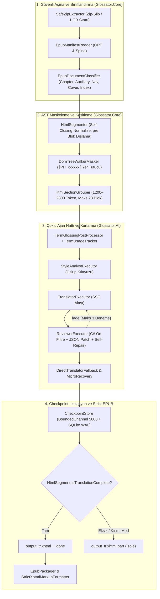

# Glossator — .NET 10 Multi-Agent EPUB Teknik Yerelleştirme Platformu

[](https://dotnet.microsoft.com/download/dotnet/10.0)
[](https://learn.microsoft.com/en-us/agent-framework/)
[](#kalite-ve-test-paketi)
[](LICENSE)

**Glossator**, İngilizce teknik kitapları ve mühendislik belgelerini (`.epub`) HTML/XHTML tasarımını, kod bloklarını ve teknik terminolojiyi bozmadan Türkçe'ye kazandıran **çok ajanlı (.NET 10 + Microsoft Agent Framework)** yerelleştirme stüdyosu (**Glossator Studio**) ve komut satırı motorudur (**Glossator CLI**).

Geleneksel çeviri araçlarının veya ham LLM istemlerinin aksine Glossator, **deterministik C# DOM ayrıştırma kurallarını**, **çevrimsel yapay zekâ iş akışlarını (`StyleAnalyst` → `Translator` ⇄ `Reviewer`)** ve **pedagojik aşamalı sözlük motorunu (`ProgressiveGloss`)** aynı boru hattında birleştirir.

---

## Görsel Çıktı Kanıtları

Gerçek bir O'Reilly teknik kitabı (*Deep Search* / *AI Engineering* vb.) üzerinde Glossator çıktılarının EPUB okuyucu görünümü:

| Karmaşık Tablo ve Kod/Matematik Koruması | Aşamalı Terminoloji ve Teknik Çeviri |
| :---: | :---: |
|  |  |

> Dikkat edilirse `<pre>`, `<code>`, `<math>` ve `<svg>` düğümleri AST düzeyinde korunmuş; başlıklar `İngilizce (Türkçe)` hiyerarşisinde sunulmuş; teknik jargon bozulmadan akıcı Türkçe sağlanmıştır.

---

## Çözüm Mimarisi (5 Proje)



### Çözüm Projeleri ([Glossator.slnx](Glossator.slnx))

| Proje | Hedef Çerçeve | Görev |
| :--- | :--- | :--- |
| **`Glossator.Core`** | `net10.0` | Güvenli EPUB açma/paketleme, `AngleSharp` DOM segmentasyonu ve `⟦PH_xxxxxx⟧` maskeleme, SQLite terim motoru, `CheckpointStore`, canlı USD/TRY `ExchangeRateService` |
| **`Glossator.AI`** | `net10.0` | `Microsoft.Agents.AI.Workflows` (`1.24.0`) döngüsel iş akışı, `ResilienceChatClient`, `RateLimitingChatClient`, `ProviderDiscoveryService`, Disk-First `PromptLoader`, OpenTelemetry `GlossatorDiagnostics` |
| **`Glossator.App`** | `net10.0-windows` | **Glossator Studio** — `WPF-UI 4.3.0` Fluent Koyu/Aydınlık masaüstü uygulaması, 6 sayfa, sürükle-bırak kitap açma, canlı günlük çekmecesi, anlık telemetri |
| **`Glossator.Cli`** | `net10.0` | Platform bağımsız (Windows/Linux/macOS) headless çeviri ve `Spectre.Console.Cli` sözlük yönetim aracı |
| **`Glossator.Tests`** | `net10.0-windows` | **42 test dosyasında 458 birim/entegrasyon testi** (`xUnit 2.9.3`) |

---

## Temel Yetenekler

### 1. Glossator Studio (Win11 Fluent Masaüstü) ve Başlıca Sayfalar
- **Kitaplığım (`LibraryView`):** Son açılan `.epub` ve açık OPF klasörlerini EPUB 2/3 kapak görseli (veya monogram fallback) kartlarıyla listeler; pencereye doğrudan `.epub` sürükle-bırak açma destekler.
- **Aktif Kitap Masası (`BookWorkspaceView`):** Bölümleri rol (`Chapter`, `Auxiliary`, `Cover`, `Navigation`, `Index`) ve durum (**Tamamlandı `.done`**, **Yarım `.part`**, **Çevrilmemiş**) bazında yönetir; aralık seçimi (`1-5, 8`), worker sayısı (`1..8`), `Sıfırdan Çevir (--fresh)`, `Test Modu`, `Kesit Limiti` ve tek tık `EPUB Paketle` sunar.
- **Terim Sözlüğü (`GlossaryView`):** Merkezi `~/.glossator/glossator.db` havuzunda arama, politika filtresi, satır içi düzenleme, toplu onay, açık kitaptan otomatik terim tarama ve YAML/JSON içe-dışa aktarım sağlar.
- **Ayarlar (`SettingsView`):** EVREN, Gemini, OpenAI, Ollama, LM Studio, vLLM, Groq, OpenRouter gibi tüm OpenAI uyumlu (`/v1`) uç noktaları yönetir; **Ping**, `/models` otomatik model keşfi, `IsEditable` model seçimi, ajan bazlı 6 kademeli **Akıl Yürütme (`ReasoningEffort`: `none`, `minimal`, `low`, `medium`, `high`, `xhigh`)** ve gömülü **Prompt Editörü** barındırır.
- **Telemetri (`TelemetryView`):** Canlı hız (`tok/s`, `TTFT`), aktif işçi, yama/red/kurtarma sayacı, `.NET Aspire` OTLP sağlık denetimi ve `ExchangeRateService` üzerinden güncel USD/TRY maliyet tahmini sunar.
- **Tema & Çekmece:** Başlık çubuğundan anlık **Koyu / Aydınlık (`DarkPalette` / `LightPalette` + Mica)** geçişi ve VS Code tarzı daraltılabilir alt çıktı/günlük çekmecesi içerir.

### 2. Pedagojik Aşamalı Sözlük (`AlwaysEnglish` / `AlwaysTurkish` / `ProgressiveGloss`)
Gömülü [seed_glossary.yaml](Glossator.Core/Resources/seed_glossary.yaml) dosyası **47 çekirdek terim** içerir; kullanıcı terimleri ve kitaplardan çıkarılan terimler `~/.glossator/glossator.db` (`GLOSSATOR_HOME` / `GLOSSATOR_DB` ile taşınabilir) içinde yönetilir:

| Politika | Strateji | Okuyucu Çıktısı |
| :--- | :--- | :--- |
| **`AlwaysEnglish`** | Markalar, protokoller ve evrensel kısaltmalar korunur | `API`, `Docker`, `LLM` |
| **`AlwaysTurkish`** | Yerleşik Türkçe teknik karşılık doğrudan kullanılır | `büyük dil modeli`, `önbellek` |
| **`ProgressiveGloss`** | Bölüm içi sayaç (`TermUsageTracker`) **1. geçişte** hibrit, **2. geçiş ve sonrasında** yalın Türkçe yazar | İlk geçiş: *bağlam penceresi (context window)* → Sonrakiler: *bağlam penceresi* |

### 3. KV-Cache Dostu Prompt Hiyerarşisi & Disk-First `PromptLoader`
* `TranslatorExecutor` ve `ReviewerExecutor` sabit `[YAZAR ÜSLUP KILAVUZU]` ve sözlük kurallarını mesajın başına (**prefix**), değişen kaynak kesiti sona (**suffix**) yerleştirerek sağlayıcı prompt cache verimliliğini artırır.
* `PromptLoader` çalışma zamanında önce `{AppContext.BaseDirectory}/Prompts/{dosyaAdı}`, ardından `{AppContext.BaseDirectory}/{dosyaAdı}` dizinlerine bakar; diskte bulunamazsa `Glossator.AI.dll` içindeki gömülü kaynağa (`EmbeddedResource`) döner (`CurrentDirectory` taranmaz). Kod derlemeden **Tıp**, **Hukuk**, **Akademi** veya **Mühendislik** alanlarına uyarlanabilir.

### 4. Kısmi Güvenlik, Kurtarma ve Token Doğruluğu
* **`HtmlSegment.IsTranslationComplete` & `.part` İzolasyonu:** Bölümde tek bir çevrilmemiş blok kalsa dahi dosya `.done` sayılmaz, `.part` olarak izole edilir; `BookLocalizationPipeline` `DirectTranslatorFallback` ve `MicroRecovery` ile eksik blokları kurtarır.
* **`ResilienceChatClient`:** `429`, `503`, `504`, `408`, `TimeoutException`, `SocketException` için jitter'lı üstel geri çekilme uygular; Gemini gibi sağlayıcıların kümülatif SSE `UsageContent` akışlarını delta/tekil nihai sayımla normalize eder ve gizli reasoning tokenlarını fatura metriğine doğru biçimde işler.
* **Güvenli Kapanış:** Pencere kapatıldığında bekleyen `CheckpointStore` kuyruğu (`BoundedChannel(5000)`) ve OTLP dışa aktarıcıları kontrollü biçimde diske yazılır/boşaltılır.

---

## Hızlı Başlangıç

### Gereksinimler
- [.NET 10 SDK](https://dotnet.microsoft.com/download/dotnet/10.0)
- **Glossator Studio (`Glossator.App`)** için Windows 10/11 (`net10.0-windows`); **CLI, Core ve AI** için Windows, Linux veya macOS (`net10.0`).
- Tercih ettiğiniz OpenAI uyumlu bir API anahtarı (EVREN, Gemini, OpenAI vb.) veya yerel **Ollama / LM Studio**.

### 1. Depoyu Klonlayın ve Testleri Doğrulayın

```powershell
git clone https://github.com/chela98/Glossator.git
cd Glossator
dotnet test Glossator.slnx --configuration Release
```

### 2. Glossator Studio'yu Başlatın (Önerilen)

```powershell
dotnet run --project Glossator.App/Glossator.App.csproj
```

İlk açılışta hem **Glossator Studio** hem **Glossator CLI**, [Glossator.Cli/appsettings.example.json](Glossator.Cli/appsettings.example.json) şablonunu temel ayar katmanı olarak otomatik yükler (`Evren` varsayılan aktif profil; yanında `Gemini`, `OpenAI`, yerel `Ollama` ve `Custom` hazır profilleri gelir). Sağ üstten tema tercihinizi seçebilir, **Ayarlar** sekmesinden API anahtarınızı girip (veya başka sağlayıcı seçip) **Ping** ile bağlantıyı test edebilir, **Modelleri Çek** butonuyla mevcut modelleri dropdown listelerine aktarabilirsiniz. Ayarlar repo dışında `~/.glossator/user_settings.json` dosyasında saklanır.

> İsterseniz yerel ortamınız için uygulama yanında kendi `appsettings.json` dosyanızı da oluşturabilirsiniz (`.gitignore` kapsamındadır).

### 3. Glossator CLI ile Headless Kullanım

```powershell
# EPUB yerelleştirme (paralel 3 işçi)
dotnet run --project Glossator.Cli -- "C:\Kitaplar\kitap.epub" -o "kitap_TR.epub" -j 3

# Sadece ilk 2 kesiti test amaçlı çalıştırma (.part izole çıktı üretir)
dotnet run --project Glossator.Cli -- "C:\Kitaplar\kitap.epub" --count 2 --test

# Merkezi SQLite sözlüğünü CLI üzerinden yönetme
dotnet run --project Glossator.Cli -- glossary list --policy ProgressiveGloss --search "agent"
dotnet run --project Glossator.Cli -- glossary export master_glossary.yaml -f yaml
dotnet run --project Glossator.Cli -- glossary import ./glossary.extracted.yaml
```

### 4. .NET Aspire Dashboard ile Canlı Gözlemlenebilirlik (İsteğe Bağlı)

```powershell
docker run --rm -it -d -p 18888:18888 -p 4317:18889 --name aspire-dashboard mcr.microsoft.com/dotnet/aspire-dashboard:latest
```

Ardından tarayıcıdan `http://localhost:18888` adresini açarak her kesit için trace waterfall, TTFT, tok/s ve düşünme (reasoning) dahil token tüketimini izleyebilirsiniz (`OpenTelemetry:Endpoint` varsayılanı: `http://localhost:4317`).

---

## Kalite ve Test Paketi

- **CI Pipeline ([.github/workflows/ci.yml](.github/workflows/ci.yml)):** `windows-latest` üzerinde tam çözüm `.NET 10` Release `restore`/`build`/`test` koşar; `ubuntu-latest` üzerinde ise `Glossator.Cli` (`net10.0`) çapraz platform derlemesi doğrulanır.
- **Release Otomasyonu ([.github/workflows/release.yml](.github/workflows/release.yml)):** `v*` tag'i ile tetiklendiğinde Windows Studio (`Glossator-Studio-win-x64.zip` + `GLOSSATOR_SMOKE_TEST=1` doğrulaması), Windows/Linux self-contained CLI paketleri (`win-x64`, `linux-x64`) ve `SHA256SUMS.txt` otomatik yayınlanır.
- **Test Kapsamı:** `Glossator.Tests` içinde `42` test dosyasında **`458 / 458`** birim ve entegrasyon testi sıfır hata / sıfır uyarı ile geçer (`ReasoningEffortMappingTests`, `ProviderDiscoveryServiceTests`, `SettingsViewModelTests`, `BookLocalizationPipelineTests`, `CyclicTranslationWorkflowTests`, `ResilienceChatClientTests`, `SafeZipExtractorTests`, `StrictXhtmlMarkupFormatterTests` vb.).
- **Duman Testi:** `GLOSSATOR_SMOKE_TEST=1` ortam değişkeni ile `Glossator.App.exe` Release başlangıç-kapanış sağlık kontrolü çıkış kodu `0` ile doğrulanmıştır.

---

## Kapsamlı Dokümantasyon

| Belge | İçerik |
| :--- | :--- |
| **[Sistem Mimarisi ve Veri Akışı](docs/ARCHITECTURE.md)** | 5 projenin bağımlılık grafiği, AST maskeleme, MAF döngüsel iş akışı, `ResilienceChatClient` ve OpenTelemetry detayları |
| **[Studio ve CLI Kullanım Kılavuzu](docs/STUDIO_AND_CLI_GUIDE.md)** | Studio 6 sayfası, `.part`/`.done` yönetimi, CLI bayrakları, Aspire Dashboard ve Calibre PDF↔EPUB dönüşümü |
| **[Yapılandırma, Sağlayıcılar ve Reasoning](docs/CONFIGURATION_AND_PROVIDERS.md)** | Öncelik zinciri, EVREN/Gemini/OpenAI/Ollama ayarları, Ping & `/models` keşfi, `none..xhigh` akıl yürütme ve `PromptLoader` |
| **[EVREN AI Showcase Özeti](docs/EVREN_SHOWCASE.md)** | Hibrit sağlayıcı stratejisi ve projenin yönetici özeti |
| **[Teknik Mülakat Hazırlık Kartı](docs/INTERVIEW_CHEATSHEET.md)** | Sistem tasarımı soru-cevapları ve kök neden mühendislik çözümleri |
| **[GitHub Hazırlık Notları](docs/GITHUB_READINESS_NOTES.md)** | Tamamlanan kalite/yayın kapıları ve dağıtım güvenlik notları |
| **[Uygulama Planı](plan.md)** & **[Yol Haritası](roadmap.md)** | Faz 0–8 mimari evrimi ve `v2.2+` gelecek hedefleri |

---

## Geliştirici & Lisans

- **Geliştirici:** Emre Dalbudak (`@chela98`) — [GitHub](https://github.com/chela98) · [LinkedIn](https://www.linkedin.com/in/emre-dalbudak/)

### Lisans
Bu proje **[MIT Lisansı](LICENSE)** altında açık kaynak olarak sunulmaktadır.
