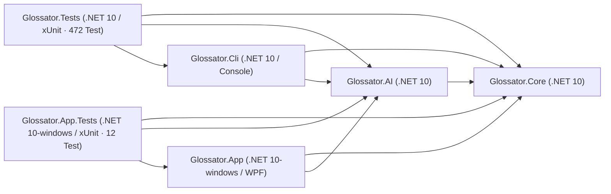
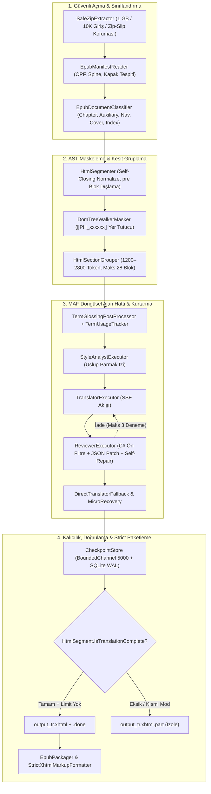

# Glossator — Sistem Mimarisi ve Veri Akışı

Bu belge, **Glossator** çözümünün tüm katmanlarını (`Glossator.Core`, `Glossator.AI`, `Glossator.App`, `Glossator.Cli`, `Glossator.Tests`, `Glossator.App.Tests`), ajan iş akışlarını, dayanıklılık ara yazılımlarını, güvenlik sınırlarını ve kalıcılık mekanizmalarını kod düzeyinde detaylandırır.

---

## 1. Çözüm Yapısı ve Bağımlılık Grafiği

Çözüm dosyası ([Glossator.slnx](../Glossator.slnx)) altı projeden oluşur (sürüm yönetimi [Directory.Packages.props](../Directory.Packages.props) üzerinden Central Package Management ve [Directory.Build.props](../Directory.Build.props) + [.editorconfig](../.editorconfig) ile merkezileştirilmiştir):

### Kullanılan Başlıca Paketler

| Katman | Proje | Öne Çıkan Bağımlılıklar |
| :--- | :--- | :--- |
| Çekirdek & EPUB Motoru | `Glossator.Core` | `AngleSharp 1.8.3`, `AngleSharp.Xml 1.2.0`, `Microsoft.Data.Sqlite 10.0.12`, `YamlDotNet 18.1.0` |
| Çoklu Ajan & LLM İstemcisi | `Glossator.AI` | `Microsoft.Agents.AI 1.24.0`, `Microsoft.Agents.AI.Workflows 1.24.0`, `Microsoft.Extensions.AI 10.10.0`, `Microsoft.Extensions.AI.OpenAI 10.10.1`, `Microsoft.Extensions.Http 10.0.12`, `System.Threading.RateLimiting 10.0.12` |
| Masaüstü Stüdyo | `Glossator.App` | `WPF-UI 4.3.0`, `Microsoft.Extensions.Hosting 10.0.12`, `OpenTelemetry.Exporter.OpenTelemetryProtocol 1.19.1`, `OpenTelemetry.Extensions.Hosting 1.19.1`, `OpenTelemetry.Instrumentation.Http 1.19.0` |
| Terminal & Otomasyon | `Glossator.Cli` | `Spectre.Console 0.57.2`, `Spectre.Console.Cli 0.57.2`, `Microsoft.Extensions.Hosting 10.0.12`, `OpenTelemetry.* 1.19.x` |
| Çapraz-Platform Test Paketi | `Glossator.Tests` | `xUnit 2.9.3`, `Microsoft.NET.Test.Sdk 17.14.1`, `Spectre.Console.Testing 0.57.2` *(41 dosya, 472 test)* |
| Studio / WPF Test Paketi | `Glossator.App.Tests` | `xUnit 2.9.3`, `Microsoft.NET.Test.Sdk 17.14.1`, `coverlet.collector 6.0.4` *(3 test dosyası, 12 test)* |

> **Platform Notu:** `Glossator.Core`, `Glossator.AI`, `Glossator.Cli` ve `Glossator.Tests` (`472` test) platform bağımsız `net10.0` hedefler (Ubuntu Linux dahil tüm işletim sistemlerinde derlenir ve koşar); yalnızca `Glossator.App` ve `Glossator.App.Tests` (`12` test) WPF nedeniyle `net10.0-windows` hedefler.

---

## 2. Uçtan Uca 4 Aşamalı İşleme Hattı

---

## 3. Çekirdek Bileşenler (`Glossator.Core`)

### 3.1 Güvenlik ve Dosya Sistemi Hijyeni
* **`SafeZipExtractor`** ([SafeZipExtractor.cs](../Glossator.Core/Security/SafeZipExtractor.cs)): `.epub` arşivlerini açarken arşiv giriş sayısını (`MaxEntryLimit = 10_000`), toplam açılmış boyutu (`MaxTotalExtractionBytes = 1 GB` sıkıştırma bombası koruması) ve hedef dizin dışı yazma girişimlerini (Zip-Slip `SecurityException`) denetler.
* **`PathSanitizer`** ([PathSanitizer.cs](../Glossator.Core/Security/PathSanitizer.cs)): Windows ayrılmış aygıt adlarını (`CON`, `PRN`, `AUX`, `NUL`, `COM1..9`, `LPT1..9`, `CLOCK$`), geçersiz karakterleri ve 100 karakterlik taban uzunluk sınırını temizleyerek güvenli `*_TR.epub` çıktı yolları üretir.
* **`GlossatorPaths`** ([GlossatorPaths.cs](../Glossator.Core/Data/GlossatorPaths.cs)): Kullanıcı çalışma dizinini (`~/.glossator` veya `GLOSSATOR_HOME`), ana SQLite veritabanını (`glossator.db` veya `GLOSSATOR_DB`) ve kullanıcı ayarlarını (`user_settings.json`) taşınabilir biçimde çözümler.

### 3.2 EPUB Ayrıştırma, Maskeleme ve Kesit Gruplama
* **`EpubManifestReader` & `EpubDocumentClassifier`** ([EpubDocumentClassifier.cs](../Glossator.Core/Parsing/EpubDocumentClassifier.cs)): EPUB 2 (NCX / meta cover) ve EPUB 3 (`properties="nav"`, `cover-image`) standartlarını destekler. Belgeleri `Cover`, `Navigation`, `Index` (alfabetik fihrist — LLM çevirisinden muaf), `Auxiliary` ve `Chapter` olarak sınıflandırır; gerçek başlıkları HTML DOM'undan (`h1`, `h2`, `title`) dinamik çıkarır.
* **`HtmlSegmenter`** ([HtmlSegmenter.cs](../Glossator.Core/Parsing/HtmlSegmenter.cs)):
  * Çeviri öncesi `NormalizeXhtmlContent` ile satır içi kendi kendine kapanan etiketleri (`<a .../>`, ``) tam açık-kapanışlı hale getirir ki HTML5 ayrıştırıcısı metni yutmasın.
  * `<pre>` bloklarının içini hiçbir koşulda segmentasyona sokmaz.
  * Çevrilebilir etiketleri (`p`, `h1..h6`, `figcaption`, `caption`, `th`, `td`, `blockquote`, `dt`, `dd`, `li`) ayıklar; içinde alt blok barındıran karmaşık `<li>` gibi elemanlarda satır içi düğüm kümelerini ayrı segmentler olarak yakalar.
* **`DomTreeWalkerMasker`** ([DomTreeWalkerMasker.cs](../Glossator.Core/Parsing/DomTreeWalkerMasker.cs)):
  * `code`, `kbd`, `samp`, `var`, `math`, `svg`, `tt` etiketlerini ve teknik satır içi düğümleri `⟦PH_000001⟧` biçiminde yer tutuculara dönüştürür.
  * `NormalizeTokens` ile LLM'in `[PH_1]`, `{{CODE_1}}` veya `(INDEX_01)` gibi bozduğu varyantları dahi kanonik `⟦PH_000001⟧` formatına normalize ederek geri yükler.
  * `IsPureTechnicalOrPlaceholder` ile salt yer tutucu, sayı, e-posta, URL, P.O. Box, şehir/posta kodu veya tek kelimelik marka/ürün adlarının (ör. `Neo4j`, `Mem0`) çevrilmeden kalmasının doğal olduğunu ayırt eder.
* **`HtmlSectionGrouper`** ([HtmlSectionGrouper.cs](../Glossator.Core/Parsing/HtmlSectionGrouper.cs)):
  * `MinTokenLimit = 1200`: Mevcut sepette 1200 token birikmeden `h2`/`h3` alt başlıklarında bölünme yapmaz (küçük parçalarla gereksiz LLM çağrısını önler).
  * `SoftTokenLimit = 2000`: 2000 token eşiğinde ikincil sınır etiketlerinde (`h4..h6`, `dt`, `blockquote`, `hr`) böler.
  * `HardTokenLimit = 2800` & `MaxSegmentsPerSection = 28`: Çıktı kesilmesini önlemek için mutlak token ve segment tavanı uygular (`h1` geldiğinde ise mevcut sepet doluysa her zaman yeni kesit başlatır).

### 3.3 Terim Yönetimi (`TermGlossingPostProcessor` & `TermUsageTracker`)
* **Veri Kaynağı:** Gömülü [seed_glossary.yaml](../Glossator.Core/Resources/seed_glossary.yaml) başlangıçta 47 çekirdek terim sağlar; kullanıcı terimleri ve kitaplardan çıkarılan terimler `~/.glossator/glossator.db` içinde SQLite (`Terms` tablosu) üzerinde yaşar. `IsReviewed = 1` olan onaylı terimler yeniden içe aktarımda asla ezilmez.
* **Sınır Güvenli Eşleme:** `EnglishTermMatcher` terimleri en uzun İngilizce ifadeden kısaya doğru, kelime sınırlarını koruyarak eşler.
* **Bölüm İçi Durum Makinesi (`TermUsageTracker` —** [TermUsageTracker.cs](../Glossator.Core/Rules/TermUsageTracker.cs)**):**
  * `GlossingPolicy.AlwaysEnglish` (`1`): Olduğu gibi bırakılır (`API`, `LLM`, `Docker`).
  * `GlossingPolicy.AlwaysTurkish` (`2`): Doğrudan Türkçe karşılığı uygulanır.
  * `GlossingPolicy.ProgressiveGloss` (`0`): Her yeni bölümde (`BeginNewScope`) sayaç sıfırlanır. **1. geçişte (`currentCount <= 1`)** hibrit `Türkçe (İngilizce)`, **2. geçiş ve sonrasında** yalın `Türkçe` uygulanır. Önbellekten (checkpoint) yüklenen kesitler de `RegisterCachedSectionUsageAsync` ile sayaca işlenir ki sonraki kesitlerin parantez kuralı şaşmasın.

### 3.4 Single-Writer Checkpoint & Katı EPUB Paketleme
* **`CheckpointStore`** ([CheckpointStore.cs](../Glossator.Core/Data/CheckpointStore.cs)): Çoklu işçi (`Parallel.ForEachAsync`) çakışmalarını engellemek için varsayılan `5000` kapasiteli `BoundedChannel<object>` kuyruğu kullanır. Tek bir arka plan yazıcı görevi, öğeleri 50 kayıtlık veya 100 ms pencerelerle SQLite WAL veritabanına toplu (micro-batch) yazar; `FlushAsync` ise bekleyen tüm kayıtların fiziksel olarak diske işlenmesini bekler.
* **`HtmlSegment.IsTranslationComplete`** ([HtmlSegment.cs](../Glossator.Core/Parsing/HtmlSegment.cs)): Bir segmentin boş olmadığını, orijinal İngilizceden farklılaştığını veya doğal olarak aynı kalabilen kitap adı/yazar/marka/teknik blok olduğunu doğrular. Tüm bloklar tamamlanmadığında veya kısmi/test modu aktifken bölüm `.done` yerine `.part` olarak kaydedilir; böylece yarım kalan bir bölüm son `.epub` paketine yanlışlıkla dahil edilmez.
* **`StrictXhtmlMarkupFormatter` & `EpubPackager`** ([EpubPackager.cs](../Glossator.Core/Packaging/EpubPackager.cs)): Void XML elemanlarını (`br`, `hr`, `img`, `meta`, `link` vb.) ` />` ile kapatır, NBSP karakterini `&#160;` biçimine çevirir, kök dışındaki çelişkili `lang="en"` özniteliklerini temizler, `mimetype` girişini sıkıştırmasız (`CompressionLevel.NoCompression`) ilk girdi olarak yazar, `OPF`, `NCX` ve `NAV` dosyalarındaki bağlantıları `_tr` hedeflerine göre çift yönlü günceller ve geçici `.delivery.tmp` üzerinden atomik yeniden adlandırmayla final `.epub` dosyasını teslim eder.

---

## 4. Çoklu Ajan ve LLM Ara Yazılım Mimarisi (`Glossator.AI`)

### 4.1 IChatClient Ara Yazılım (Middleware) Zinciri
[AiServiceExtensions.cs](../Glossator.AI/Extensions/AiServiceExtensions.cs) üç ajanı (`StyleAnalyst`, `Translator`, `Reviewer`) `AddKeyedTransient<IChatClient>` ile kaydeder ve seçenekleri `IOptionsMonitor<GlossatorAiOptions>` üzerinden canlı okur. `ChatClientBuilder` dıştan içe doğru şu sırayla sarar:

1. **`UseOpenTelemetry` (En Dış Katman):** Nihai normalize edilmiş kullanım metriklerini (`UsageContent`) yakalar; ham prompt/çeviri metinleri (`EnableSensitiveData`) varsayılan olarak gizlidir ve yalnızca `OpenTelemetry:CaptureMessageContent` / `GlossatorAi:EnableSensitiveTelemetry` açık olduğunda kaydedilir.
2. **`UseLogging`:** `ILoggerFactory` üzerinden yapılandırılmış loglama.
3. **`ResilienceChatClient`** ([ResilienceChatClient.cs](../Glossator.AI/Clients/ResilienceChatClient.cs)):
   * `408`, `429`, `502`, `503`, `504` HTTP kodları, `TimeoutException` (ağ zaman aşımı), `SocketException`, `IOException` ve özel LLM proxy hata metinleri için varsayılan **3 toplam denemeli (`maxRetries = 3`: 1 ilk deneme + 2 yeniden deneme, initial delay 2s, `60s` tavanlı) jitter'lı üstel geri çekilme** uygular ve sunucunun `Retry-After` / `retry-after-ms` başlıklarına saygı duyar; çağıran `cancellationToken` iptal sinyali geldiğinde anında durur.
   * **Kümülatif SSE Token Koruması:** Gemini gibi sağlayıcıların her SSE parçasında kümülatif `UsageContent` göndermesi nedeniyle OpenTelemetry toplayıcılarının token sayısını katlayarak şişirmesini (`10K -> 100K`) önler; ara parçalardaki `UsageContent` öğelerini sıyırıp akış sonunda yalnızca tekil nihai `UsageContent` yayınlar.
   * **Gizli Reasoning Token Hesabı (`NormalizeUsageContent`):** `total > input + output` olduğunda aradaki gizli düşünme (thinking) token farkını `OutputTokenDetails.ReasoningTokenCount` içine kaydeder ve `OutputTokenCount` değerini gerçek faturalandırılan çıktıya eşitler.
4. **`RateLimitingChatClient`:** Paylaşılan singleton `TokenBucketRateLimiter` (dakikada 60 jeton, kuyruk limiti 100) ile tüm worker'ların toplam istek hızını sınırlar.
5. **Reasoning Effort Enjeksiyonu (En İç Katman):** Ajan için tanımlı `ReasoningEffort` (`none`, `minimal`, `low`, `medium`, `high`, `xhigh` veya özel değer) varsa `AdditionalProperties["reasoning_effort"]` ve OpenAI SDK `ChatCompletionOptions.ReasoningEffortLevel` üzerine enjekte edilir.

### 4.2 MAF Döngüsel İş Akışı ve 3 Katmanlı Güvenlik Ağı
* **`CyclicTranslationWorkflow`** ([CyclicTranslationWorkflow.cs](../Glossator.AI/Workflows/CyclicTranslationWorkflow.cs)): Microsoft Agent Framework `WorkflowBuilder` üzerinde `StyleAnalyst -> Translator -> Reviewer` kenarlarını ve `AddSwitch(reviewer, ...)` geri besleme döngüsünü kurar (`MaxReviewAttempts = 3`).
* **KV-Cache Dostu Prompt Hiyerarşisi:** Hem `TranslatorExecutor` hem `ReviewerExecutor`, bölüm bazlı sabit `[YAZAR ÜSLUP KILAVUZU]` ve sözlük kurallarını kullanıcı mesajının başına (prefix), değişen kaynak metni ise sonuna (suffix) koyar.
* **Reviewer 3 Aşamalı Doğrulama** ([ReviewerExecutor.cs](../Glossator.AI/Executors/ReviewerExecutor.cs)):
  1. *Deterministik C# Ön Filtresi:* Eksik `[BLOK_xxx]` veya yer tutucu varsa LLM Reviewer'a hiç gitmeden (0 ms, 0 token) taslağı Translator'a iade eder.
  2. *JSON Patch + 1-Shot Self-Repair:* Reviewer yalnızca değişen blokları JSON Patch döndürür. Geçersiz JSON dönerse Translator'a ceza kesmeden önce Reviewer'a kendi JSON çıktısını onarması için tek seferlik fırsat verir (`TrySelfRepairJsonAsync`).
  3. *C# Gatekeeper:* Uygulanan yama herhangi bir maske/blok kaybına yol açarsa yamayı reddedip çevirmenin sağlam taslağını korur.
* **Kurtarma Ağları (`BookLocalizationPipeline` —** [BookLocalizationPipeline.cs](../Glossator.AI/Workflows/BookLocalizationPipeline.cs)**):**
  * Döngü beklenmedik biçimde boş metin dönerse `DirectTranslatorFallback` çalışır.
  * `TryUnpackTranslations` sonrasında eksik blok kalırsa `MicroRecovery` yalnızca eksik bloklar (`CreateDeltaSection`) için hedefli delta çağrısı yapar.

### 4.3 Canlı Akış & Sağlayıcı Keşfi
* **`StreamingChatHelper`** ([StreamingChatHelper.cs](../Glossator.AI/Streaming/StreamingChatHelper.cs)): SSE yanıt beklerken her 1 saniyede kalp atışı (`heartbeat`) sinyali üretir; **TTFT** (`ms`) ve **TPS** (`tok/s`) hesaplayarak `GlossatorDiagnostics` histogramlarını besler.
* **`ProviderDiscoveryService`** ([ProviderDiscoveryService.cs](../Glossator.AI/Services/ProviderDiscoveryService.cs)):
  * `PingAsync`: Önce `GET /models` ile gecikme ve anahtar kontrolü yapar (başarılıysa model listesini de döndürür). `/models` `404`/`405`/`501` dönerse ve `Varsayılan Model` girilmişse hafif `POST /chat/completions` (`max_tokens: 1`, model gerektiriyorsa otomatik `max_completion_tokens: 1` yeniden denemesi) ile ping doğrular.
  * `FetchModelsAsync`: OpenAI `{ data: [...] }` ve Ollama `{ models: [...] }` şemalarını ayrıştırır, Gemini uyumlu uç noktalardaki `models/` önekini temizler.

---

## 5. Masaüstü Uygulaması (`Glossator.App`) & Telemetri

* **Kabin & Navigasyon:** [ShellWindow.xaml](../Glossator.App/Views/ShellWindow.xaml) + [ShellViewModel.cs](../Glossator.App/ViewModels/ShellViewModel.cs) ile sol sabit kenar çubuğu (6 sayfa + Son Kitaplar hızlı listesi), başlık çubuğunda tek tık Koyu/Aydınlık tema anahtarı (`StudioThemeService`), sürükle-bırak `.epub` açma ve VS Code tarzı daraltılabilir alt çıktı çekmecesi sunar.
* **Güvenli Kapanış:** Pencere kapanırken veya `Application_Exit` sırasında `CheckpointStore.DisposeAsync()` ile bekleyen checkpoint'leri boşaltır ve OTLP gRPC dışa aktarıcılarının arayüzü dondurmaması için host kapanışına kısa zaman aşımı uygular.
* **Gözlemlenebilirlik (`GlossatorDiagnostics` & `StudioTelemetryMonitor`):**
  * `glossator.sections.translated`, `glossator.chapters.translated`, `glossator.reviewer.patches_applied`, `glossator.reviewer.rejections`, `glossator.recovery.attempts`, `glossator.workers.active`, `glossator.genai.ttft`, `glossator.genai.tps`, `glossator.genai.tokens_streamed` metriklerini `MeterListener` üzerinden gerçek zamanlı UI'a ve OTLP (`localhost:4317`) aracılığıyla .NET Aspire Dashboard'a aktarır.
* **Canlı Kur Servisi (`ExchangeRateService` —** [ExchangeRateService.cs](../Glossator.Core/Services/ExchangeRateService.cs)**):** API anahtarı gerektirmeyen `Frankfurter (ECB)` birincil ve `ExchangeRate-API` yedek kaynaklarından 6 saatlik bellek içi önbellek + 4 saniyelik zaman aşımıyla USD/TRY kuru çeker; çevrimdışı durumda kullanıcının kayıtlı kuruna veya `38.00` yedeğine düşer.
